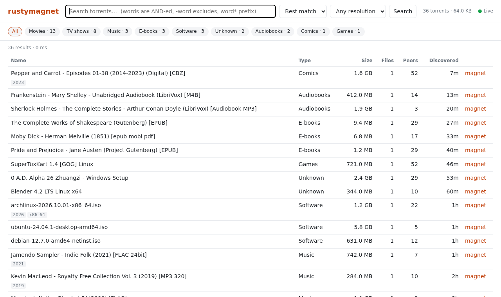
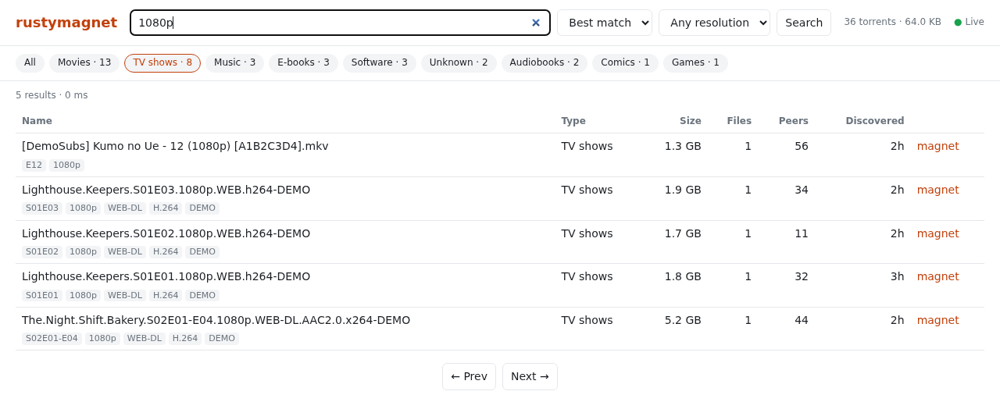

# rustymagnet

A self-hosted BitTorrent DHT crawler, classifier and search engine in the spirit of
[bitmagnet](https://bitmagnet.io), written in Rust to keep a NAS responsive with
millions of indexed torrents.

It ships as a single ~3 MB binary. It needs no PostgreSQL, no Redis and no external services,
because everything lives in one SQLite file.





The screenshots use a small demo database of public-domain and openly licensed releases
(the names are made up), imported with `rustymagnet import`. Imported torrents have no
file lists, so every row shows one file.

## Features

- **DHT crawler**: BEP 5 node with BEP 51 `sample_infohashes` crawling. It answers incoming
  `ping`/`find_node`/`get_peers`/`announce_peer` queries and collects the info hashes they
  reveal. For unknown hashes it looks up peers with `get_peers` and downloads metadata with
  BEP 9/10 (`ut_metadata`), checking it against the info hash. It races several peers per torrent.
- **Classifier**: same content types as bitmagnet: `movie`, `tv_show`, `music`, `ebook`,
  `comic`, `audiobook`, `game`, `software`, `xxx` (plus `unknown`). It also extracts
  release attributes: title, year, season/episodes (`S01E02`, `S01E01-E03`, `S01-S03`,
  anime absolute numbers, `Cap.104`), resolution, source, video codec, modifiers
  (REMUX, 3D, HDR…), languages and release group.
- **Search**: SQLite FTS5 full-text search over torrent and file names. It supports filters
  (type, year, resolution, season/episode, size) and sorting (relevance, newest, oldest,
  size, peers).
- **Web UI** at `http://<host>:3333/`, with content-type facets, file lists and magnet links.
  It updates live: new torrents appear at the top of the newest-first list as they are indexed,
  and other views offer a refresh link. Click "Live" in the header to pause.
- **Torznab API** for Sonarr / Radarr / Lidarr / Readarr / Prowlarr.
- **JSON API**.
- **Import** from an existing bitmagnet database.
- **Content blocklist**: torrents whose names indicate child sexual abuse material are never
  stored. Adult content can be dropped entirely with `--skip-xxx`.

## Why it is lighter than bitmagnet

| | bitmagnet | rustymagnet |
|---|---|---|
| Storage | PostgreSQL with one row per file, tsvector and several indexes | SQLite: one row per torrent, file list as one compact blob, contentless FTS5 index |
| Writes | many small transactions | one writer thread, batched commits (≤1000 rows / 1 s) |
| "Already known?" check | database queries | in-memory Bloom filter (no DB access on the hot path) |
| Facet counts | aggregate queries over the whole table | counters maintained on insert |
| Result totals | exact counts | capped at 10 000 ("10 000+") |
| Processes | app + Postgres (+ optional Redis) | one binary, ~40–60 MB RSS while crawling |

Measured in the development container with 3 000 000 synthetic torrents imported
(names only, no file lists):

| | |
|---|---|
| Import | ~2 min, 645 MB database |
| Search, selective term (`kinsor`, 4 319 hits) | 17 ms |
| Search, very common term (`1080p`, ~1M hits), by relevance | ~280 ms |
| Browse newest / type facet / stats / Torznab TV search | ≤ 1 ms |

Real crawled torrents also store their file lists, so expect a bigger database per torrent.
You can shrink it with `--no-file-index`, which only indexes torrent names for search.

For sizing a large index (15 M crawled-like torrents, 65 GB: disk, RAM, search times and
what is still slow), see [docs/scaling.md](docs/scaling.md). Text searches sorted by relevance,
size or peers sort the newest 100 000 matches, so very common words stay fast on a large index.
A search that still takes longer than 3 seconds is stopped with "add more words or filters".

## Benchmarks: resource usage while crawling

The release binary crawled the live DHT for 10 minutes with the default settings
(`--rate 150`, `--fetchers 64`, `--max-nodes 50000`). It started from an empty database,
ran in a Docker container behind NAT on a 16-core machine with 7.7 GB RAM, and had no
inbound UDP port forwarded. CPU time and RSS come from `/proc/<pid>`, sampled every 10 s.
The torrent, packet and node counts come from `/api/stats`.

| Time | CPU (% of one core) | RSS | DHT nodes | Torrents stored | Database |
|---:|---:|---:|---:|---:|---:|
| 1 min | 1.4 % | 38 MB | 23 071 | 166 | 4.9 MB |
| 2 min | 1.6 % | 45 MB | 37 565 | 222 | 4.9 MB |
| 5 min | 1.3 % | 49 MB | 50 000 (cap) | 468 | 6.1 MB |
| 10 min | 1.2 % | 59 MB | 50 000 (cap) | 838 | 8.4 MB |

Over the whole 10 minutes:

| | |
|---|---|
| CPU | 1.0–1.7 % of one core (average 1.3 %) |
| Memory | 33 MB RSS at start, 61 MB peak. 6–7 threads |
| DHT packets | ~151 out/s (the `--rate`), ~114 in/s (about 75 % answered) |
| Network | ~1.1 Mbit/s down, ~0.3 Mbit/s up for the whole container, including metadata downloads |
| Torrents | ~1.3/s stored (about 110 000 per day). 840 metadata fetches succeeded and 7 942 failed, mostly because of timeouts or refused connections |

RSS grows mainly while the routing table fills up to `--max-nodes`, then levels off.
With a 15 M-torrent database it was 92 MB after 3 minutes of crawling, because the
Bloom filter of known hashes is bigger. See [docs/scaling.md](docs/scaling.md#ram). The DHT
rate, not the CPU, is what limits the crawler. See [Choosing `--rate`](#choosing---rate)
before you raise it.

## Running

### Docker (recommended on a NAS)

```sh
docker compose up -d --build
```

The container starts as root only long enough to make `./data` owned by `PUID:PGID`
(default `1000:1000`, set in `docker-compose.yml`), then runs rustymagnet as that user.
If you run it with `user:` instead, `./data` must already be writable by that user
(`sudo chown -R <uid>:<gid> data`); otherwise the container exits at once and says so.

Then open `http://<nas>:3333/`. Forward **UDP 3334** on your router: the crawler works
without it, but the DHT sends you far more traffic (and announces) when other nodes can
reach you. Peer connections are outbound only.

The Gitea workflow in `.gitea/workflows/build.yml` builds the image on every push to
`main` and pushes it as `gitea.internal:30008/nine9/rusty-magnet:<sha8>` and `:latest`.
It needs the repository secrets `REGISTRY_USER` and `REGISTRY_TOKEN`. If the runner can't
reach Docker Hub reliably, set the repository variables `RUST_IMAGE` and `BASE_IMAGE` to
copies of `rust:1-slim-bookworm` and `debian:bookworm-slim` in your own registry.

### Bare metal

```sh
cargo build --release
./target/release/rustymagnet --db /path/to/rustymagnet.db
```

### Options

| Flag | Environment | Default | |
|---|---|---|---|
| `--db PATH` | `RUSTYMAGNET_DB` | `./rustymagnet.db` | SQLite database |
| `--http ADDR` | `RUSTYMAGNET_HTTP` | `0.0.0.0:3333` | Web UI / API |
| `--dht-port PORT` | `RUSTYMAGNET_DHT_PORT` | `3334` | DHT UDP port |
| `--rate N` | `RUSTYMAGNET_RATE` | `150` | Outgoing DHT queries/second. **The main load knob**, see below |
| `--fetchers N` | `RUSTYMAGNET_FETCHERS` | `64` | Torrents whose metadata is fetched concurrently (up to 4 peer connections each) |
| `--max-nodes N` | `RUSTYMAGNET_MAX_NODES` | `50000` | DHT nodes kept in memory |
| `--cache-mb N` | `RUSTYMAGNET_CACHE_MB` | `64` | SQLite page cache per connection |
| `--query-timeout S` | `RUSTYMAGNET_QUERY_TIMEOUT` | `3` | Stop a search after S seconds with "add more words or filters". `0` = never. Raise it if the database is on a slow spinning disk |
| `--no-file-index` | `RUSTYMAGNET_NO_FILE_INDEX=1` | off | Don't full-text index file names |
| `--skip-xxx` | `RUSTYMAGNET_SKIP_XXX=1` | off | Don't store adult content |

Set the log level with `RUSTYMAGNET_LOG=error|warn|info|debug`. At `debug` the crawler
prints its counters every 10 s instead of every 60 s.

### Choosing `--rate`

Almost every DHT query goes to a different address. Every NAT on the way (Docker's bridge
network, the NAS firewall, your router) keeps a connection-tracking entry per address for
30–120 s. When the rate is too high, that table fills up and replies are silently dropped.
The crawler then sends at full speed but receives nothing. It can also slow down everything
else on the NAS and router, a common cause of "my NAS is slow" with DHT crawlers.

In testing behind Docker NAT:

- At 500 queries/s, incoming traffic stopped after about a minute.
- At 150 queries/s it stayed steady: about 75 % of queries were answered and about 1.5
  torrents/s were fetched, or roughly 130 000 per day.

If you run with `network_mode: host` and a large `nf_conntrack_max`, try raising the rate
step by step. If the `pkts in` counter stops growing while `pkts out` keeps rising, the rate
is too high.

Commands:

- `run` (default): crawl and serve.
- `serve`: UI/API only.
- `import`: see below.
- `reclassify`: re-run the classifier over the database after upgrading. This also deletes
  rows that now match the blocklist.
- `reindex`: rebuild the search index. Databases from before the type/year/resolution/season
  filters moved into the index need this once. `run` and `serve` do it by themselves at
  start-up up to 1 M torrents; above that they log a warning and keep working, only filtered
  searches stay slow. Stop the container first, and expect it to take a while and to need free
  disk space for a second copy of the index, see [docs/scaling.md](docs/scaling.md).

## Torznab (Sonarr, Radarr, Prowlarr…)

Add a generic **Torznab** indexer with URL `http://<host>:3333/torznab` (API path `/api`)
and no API key. Supported: `t=caps`, `search`, `tvsearch` (`q`, `season`, `ep`), `movie`,
`music`, `book`, with categories 2000/3000/4000/5000/6000/7000/8000 and their HD/UHD/SD
subcategories. `seeders` is the number of peers seen when the torrent was discovered.
rustymagnet does not scrape trackers, so treat it as a rough popularity signal.

## JSON API

- `GET /api/search?q=&type=movie,tv_show&year=&resolution=1080p&season=&episode=&min_size=&max_size=&sort=relevance|newest|oldest|size|smallest|peers&limit=50&offset=0`
- `GET /api/torrent/<info hash hex>` returns the torrent with its file list.
- `GET /api/stats` returns counts per content type, database size and crawler counters.
- `GET /api/events` is a server-sent event stream of the same stats JSON: sent within ~2 s of new
  torrents being stored, and at least every 10 s. At most 16 streams are open at once; further
  ones get a 503 and the web UI falls back to polling `/api/stats`.

The `q` syntax: words are AND-ed, `-word` excludes a word, `word*` matches a prefix of at least
3 characters (`ab*` searches for the word `ab`).

## Migrating from bitmagnet

Export names and sizes from bitmagnet's PostgreSQL and pipe them in:

```sh
psql -h <host> -U postgres bitmagnet -Atc "\copy (select encode(info_hash,'hex'), name, size, extract(epoch from created_at)::bigint from torrents) to stdout" \
  | rustymagnet import --db /path/to/rustymagnet.db
```

Imported torrents are classified from their names only, because file lists are not
imported. They are also added to the "known" set, so the crawler won't fetch them again.

## Security note

Like bitmagnet, there is no authentication. Keep port 3333 on your LAN or behind a reverse
proxy with auth.

## Development

```sh
cargo test
cargo clippy --all-targets
```
